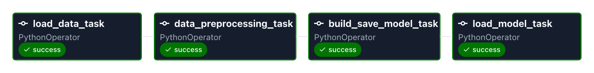
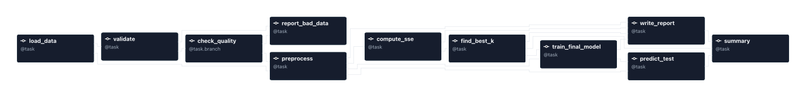
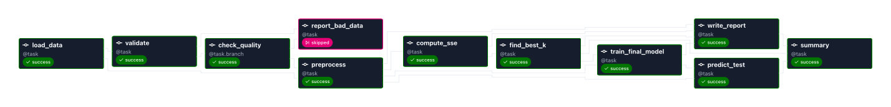
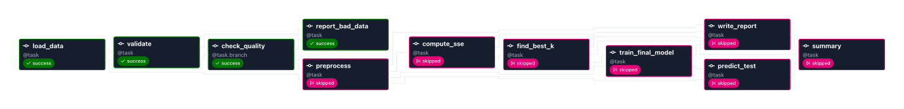
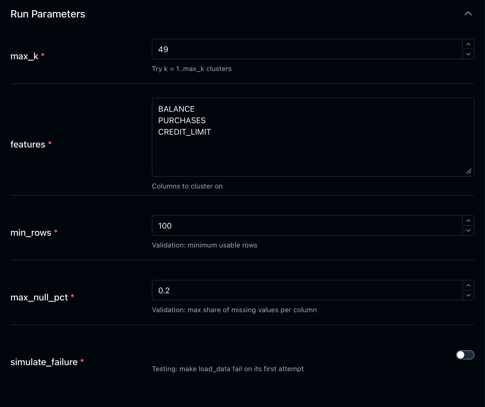
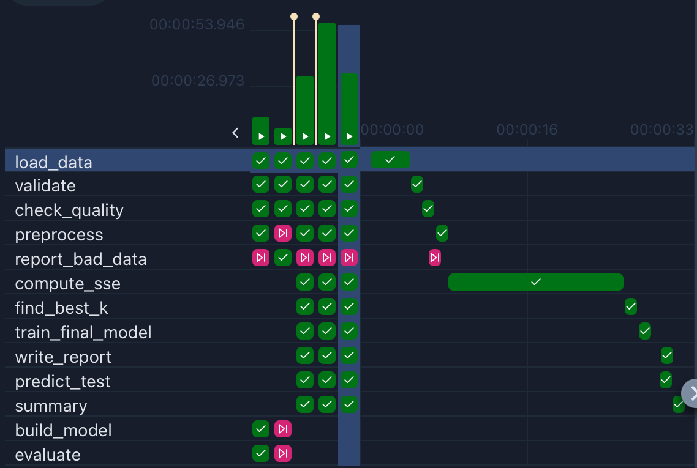
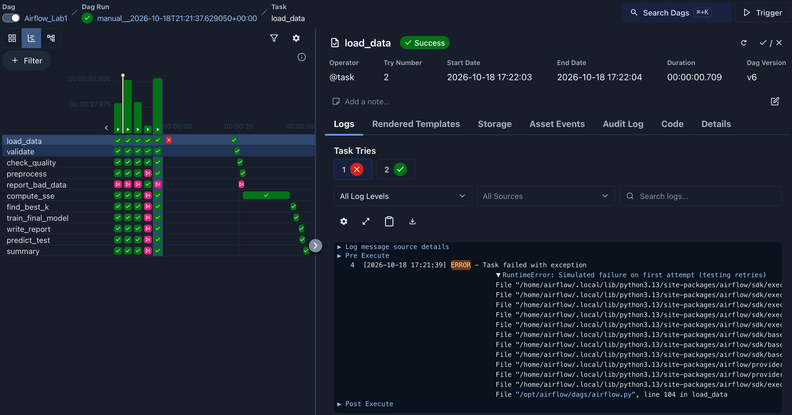

# Airflow Lab 1 – K-Means Clustering Pipeline (Enhanced)

An Apache Airflow 3 pipeline that loads a credit-card customer dataset, validates it, and clusters customers with K-Means, picking the number of clusters with the elbow method.

This is my modified version of the course's Airflow Lab 1. The original was a straight line of 4 tasks; I rebuilt the **Airflow pipeline itself** to use modern Airflow 3 features: the TaskFlow API, branching, runtime params, parallel tasks, and retries with alert callbacks. Details are in [Changes I made](#changes-i-made).

---

## Before vs After

**Before:** the original lab, a straight line of 4 tasks.



**After:** my version, 11 tasks with validation, a branch, and parallel outputs.



| | Original | My version |
|---|---|---|
| Tasks | 4 | 11 |
| DAG style | `PythonOperator` + `op_args` | TaskFlow API (`@dag`, `@task`, `@task.branch`) |
| Data between tasks | Whole dataset pickled into XCom | Only file paths in XCom |
| Data checks | None | Validation task + branch |
| Settings | Hard-coded | 5 runtime params |
| Parallel tasks | None | `predict_test` and `write_report` run together |
| Failure handling | No retries | 2 retries with backoff, timeouts, alert log |
| Model saved | Last fitted (k = 49) | Best k from elbow method |
| Test data | Not scaled | Scaled with the saved scaler |

---

## Pipeline at a glance

```
                                              ┌─→ report_bad_data                     (data FAILS checks)
load_data → validate → check_quality (branch) ┤
                                              └─→ preprocess → compute_sse → find_best_k → train_final_model ─┬─→ predict_test ──┐
                                                                                                              └─→ write_report ──┴─→ summary
```

| Task | What it does |
|---|---|
| `load_data` | Reads `data/file.csv`, saves a copy for this run |
| `validate` | Checks columns exist, are numeric, have few missing values, and that there are enough rows |
| `check_quality` | **Branch**: continues to training if data passed, otherwise goes to `report_bad_data` |
| `report_bad_data` | Logs the data problems; training is skipped |
| `preprocess` | Drops missing rows, keeps the chosen feature columns, MinMax-scales them |
| `compute_sse` | Fits K-Means for k = 1..`max_k` and records the error (SSE) for each k |
| `find_best_k` | Elbow method picks the best k |
| `train_final_model` | Trains the final model at the best k |
| `predict_test` | Scales `data/test.csv` with the saved scaler and predicts a cluster for each row |
| `write_report` | Writes `report.md` with cluster sizes and centers (runs **in parallel** with `predict_test`) |
| `summary` | Waits for both, then prints a run summary |



---

## Changes I made

All changes are to the Airflow DAG and how tasks work together. Each one is a separate commit in the Git history.

| # | Change | Airflow concept |
|---|---|---|
| 1 | Rewrote the DAG with the **TaskFlow API** and pass **file paths** through XCom instead of the data | `@dag` / `@task`, XCom best practice |
| 2 | Added a **data validation** task and a **branch** | `@task.branch`, skipped tasks |
| 3 | Added **runtime params** | `Param`, Trigger form / `--conf` |
| 4 | Split modeling into smaller tasks with **parallel fan-out / fan-in**, and fixed two ML bugs | Task dependencies, parallel execution |
| 5 | Added **retries, timeouts, callbacks, and a schedule** | `retries`, `execution_timeout`, `on_retry_callback`, `on_failure_callback`, `schedule`, `max_active_runs` |
| – | `setup.sh` generates a `FERNET_KEY`; ML library versions pinned | Environment setup |

### 1. TaskFlow API + file paths through XCom

- **Before:** `PythonOperator(..., op_args=[task.output])`. Each task pickled the entire dataset, base64-encoded it, and pushed it through XCom.
- **After:** tasks are plain Python functions with `@task`; Airflow builds the dependencies from the function calls. Each run gets its own folder `dags/output/<run_id>/`, tasks save their data there, and **only the small file path** goes through XCom.
- **Why it matters:** XCom is stored in the metadata database and is meant for small values. Pushing whole datasets through it is slow and breaks with larger data.

### 2. Data validation + branching

- `validate` checks: required columns exist, they are numeric, no column has more than `max_null_pct` missing values, and at least `min_rows` usable rows remain. The result is saved to `data_quality_report.json`.
- `check_quality` is a `@task.branch` that returns the next task to run. If the data passed, training runs and `report_bad_data` is **skipped**. If it failed, `report_bad_data` runs and the whole training path is **skipped**, so a model is never trained on bad data.



### 3. Runtime params

Settings can be changed when triggering the DAG, with no code edits:

| Param | Default | Meaning |
|---|---|---|
| `max_k` | `49` | Try k = 1..max_k clusters |
| `features` | `["BALANCE", "PURCHASES", "CREDIT_LIMIT"]` | Columns to cluster on |
| `min_rows` | `100` | Validation: minimum usable rows |
| `max_null_pct` | `0.2` | Validation: max share of missing values per column |
| `simulate_failure` | `false` | Testing: makes `load_data` fail on its first attempt |



### 4. Parallel tasks + ML fixes

- The single "build and save model" step is now `compute_sse → find_best_k → train_final_model`, so each step is visible and retryable on its own.
- `predict_test` and `write_report` both depend only on `train_final_model`, so they **run at the same time** (fan-out). `summary` waits for both (fan-in).
- **Bug fix 1:** the original saved the **last** model it fitted (k = 49) and ignored the elbow result. Now the final model is trained **at the elbow k**.
- **Bug fix 2:** the original trained on scaled data but predicted on **unscaled** test data. Now `predict_test` applies the **saved scaler** first.



### 5. Reliability

| Setting | Value | Effect |
|---|---|---|
| `retries` | 2 | A failed task is retried automatically |
| `retry_delay` + `retry_exponential_backoff` | 15 s, growing | Waits longer between each retry |
| `execution_timeout` | 10 min | A stuck task is stopped |
| `dagrun_timeout` | 30 min | A whole run can't hang forever |
| `max_active_runs` | 1 | Runs never overlap |
| `on_retry_callback` / `on_failure_callback` | – | Writes a JSON line to `dags/output/alerts.log` for every retry or failure |
| `schedule` | `0 6 * * *` | Runs daily at 06:00 UTC; manual triggers still work |



---

## Project structure

```
Lab_1/
├── README.md               ← this file
├── setup.sh                ← one-time setup script
├── docker-compose.yaml     ← Airflow 3.3.2 services (official file, 2 settings changed)
├── assets/                 ← screenshots used in this README
└── dags/
    ├── airflow.py          ← the DAG (pipeline definition)
    ├── src/
    │   ├── __init__.py
    │   └── lab.py          ← data + modeling functions
    ├── data/
    │   ├── file.csv        ← training data (credit-card customers)
    │   └── test.csv        ← rows to predict
    └── output/             ← created at runtime, one folder per run (not in Git)
```

---

## Prerequisites

You only need **Docker**. Airflow, Python, and all libraries run inside containers.

| Tool | Version I tested with | Notes |
|---|---|---|
| macOS | – | Linux works the same; on Windows use **WSL 2** |
| Docker Desktop | Docker 29.8.2, Compose v5.6.0 | Any recent version with `docker compose` (v2+) |
| Memory for Docker | **at least 4 GB** (8 GB recommended) | Docker Desktop → Settings → Resources |
| Free disk space | ~5 GB | For the Airflow image |
| `git` and `openssl` | any | Preinstalled on macOS and most Linux |

Installed inside the containers automatically:

| Package | Version |
|---|---|
| Apache Airflow | 3.3.2 (image `apache/airflow:3.3.2`) |
| Python | 3.13 |
| scikit-learn | 1.9.1 (pinned) |
| kneed | 0.8.6 (pinned) |
| pandas | 3.0.5 (comes with the image) |
| numpy | 2.5.3 (comes with the image) |

---

## Setup and run

### 1. Install Docker

Install **Docker Desktop** from <https://www.docker.com/products/docker-desktop/>, open it, and wait until it says **Engine running**. Then check:

```bash
docker --version
docker compose version
```

> **macOS tip:** if you get `zsh: command not found: docker` even though Docker Desktop is installed, add it to your PATH:
> ```bash
> echo 'export PATH="$HOME/.docker/bin:$PATH"' >> ~/.zshrc
> source ~/.zshrc
> ```

### 2. Get the code

```bash
git clone https://github.com/HiralR2931/mlops-airflow-lab.git
cd mlops-airflow-lab/Lab_1
```

### 3. Run the setup script

```bash
bash setup.sh
```

This creates the `logs/`, `plugins/` and `config/` folders, writes your user ID and a generated `FERNET_KEY` into `.env`, and downloads the Airflow image. **The first run takes a few minutes.** It prints a long list of config settings; that's normal.

### 4. Initialise the Airflow database

```bash
docker compose up airflow-init
```

Wait for `airflow-init-1 exited with code 0`.

### 5. Start Airflow

```bash
docker compose up -d
```

After 1–3 minutes, check that everything is running:

```bash
docker compose ps --format "table {{.Service}}\t{{.Status}}"
```

Every service should show **(healthy)**.

### 6. Open the UI

Go to **<http://localhost:8080>** and log in with:

- **Username:** `airflow`
- **Password:** `airflow`

Click **Dags** → **Airflow_Lab1**.

### 7. Run the pipeline

**From the UI:** click **Trigger**, keep the default params, and confirm.

**Or from the terminal:**

```bash
docker compose exec airflow-scheduler airflow dags trigger Airflow_Lab1
```

A run takes about 30–40 seconds.

---

## What a successful run looks like

**Task states** (Graph view, or `airflow tasks states-for-dag-run Airflow_Lab1 <run_id>`):

| Task | State |
|---|---|
| load_data, validate, check_quality, preprocess, compute_sse, find_best_k, train_final_model, predict_test, write_report, summary | ✅ success |
| report_bad_data | ⏭️ skipped (data passed, so this path wasn't needed) |

**Files created** in `dags/output/<run_id>/`:

```bash
ls dags/output/$(ls -t dags/output | grep -v alerts | head -1)
```

```
data_quality_report.json   final_model.sav   predictions.csv   raw.pkl   report.md   scaled.pkl   scaler.pkl
```

**Report** (`report.md`), first lines from my run:

```
# K-Means Clustering Report

- **Best k (elbow method):** 8
- **Features:** BALANCE, PURCHASES, CREDIT_LIMIT
- **k values tried:** 1..49

| Cluster | Size | BALANCE | PURCHASES | CREDIT_LIMIT |
|---|---|---|---|---|
| 0 | 1204 | 2,759.92 | 784.05 | 4,181.45 |
| 1 | 1251 | 773.37 | 1,613.26 | 7,514.62 |
| 2 | 255 | 1,060.63 | 2,612.38 | 14,191.76 |
...
```

The `summary` task log prints the best k, the number of test rows predicted, and where the files are.

---

## Try the new features

Each command triggers a run with different params. Watch it in the UI.

**Faster run with fewer k values:**

```bash
docker compose exec airflow-scheduler airflow dags trigger Airflow_Lab1 --conf '{"max_k": 20}'
```

→ Everything succeeds; `compute_sse` finishes much faster.

**Bad data path (branching):**

```bash
docker compose exec airflow-scheduler airflow dags trigger Airflow_Lab1 --conf '{"min_rows": 100000}'
```

→ `report_bad_data` **succeeds**; `preprocess` and everything after it are **skipped**. The `report_bad_data` log explains why.

**Retries and alerts:**

```bash
docker compose exec airflow-scheduler airflow dags trigger Airflow_Lab1 --conf '{"simulate_failure": true}'
```

→ `load_data` fails on try 1, retries automatically after ~15 s, and succeeds on try 2. The rest of the run finishes green. Then:

```bash
cat dags/output/alerts.log
```

```json
{"time": "...", "event": "RETRY", "dag_id": "Airflow_Lab1", "task_id": "load_data", "run_id": "manual__...", "try_number": 1, "error": "Simulated failure on first attempt (testing retries)"}
```

**Different features:**

```bash
docker compose exec airflow-scheduler airflow dags trigger Airflow_Lab1 --conf '{"features": ["BALANCE", "PURCHASES"]}'
```

> Any feature columns you choose must also exist in `data/test.csv`.

> **Note:** because the DAG has a daily schedule, Airflow may start one **scheduled** run as soon as the DAG is first loaded. That's expected.

---

## Troubleshooting

| Problem | Fix |
|---|---|
| `command not found: docker` (macOS) | See the PATH tip in step 1, and make sure Docker Desktop is open |
| `Cannot connect to the Docker daemon` | Docker Desktop isn't fully started; wait and retry |
| Services stay `health: starting` | Wait 1–2 more minutes; check memory is at least 4 GB |
| DAG not showing in the UI | Wait ~30 s and refresh; then run `docker compose exec airflow-scheduler airflow dags list-import-errors` |
| Port 8080 already in use | Stop the other app using it, or change `"8080:8080"` in `docker-compose.yaml` |
| A task is red | Click it → **Logs** to see the error |

---

## Stop and clean up

```bash
docker compose down        # stop Airflow (keeps run history)
docker compose down -v     # stop and delete the database too
```

---

## Credits

Based on Airflow Lab 1 from the Northeastern MLOps course by Ramin Mohammadi. Original lab: K-Means clustering with the elbow method, run as an Airflow DAG.
